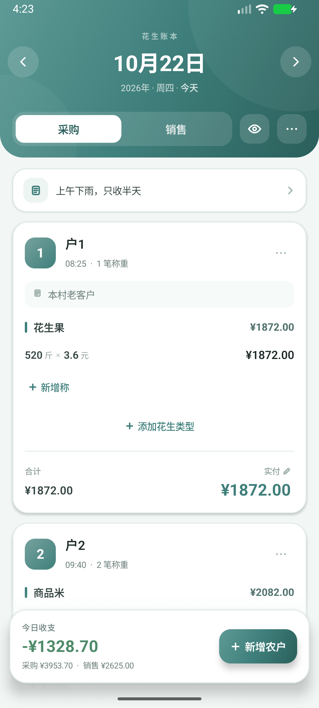

# 花生账本 · Peanut Ledger

参考 `demo_page.html` 原型实现的原生 Android 记账 App，用于花生收购与销售场景。**纯本地运行，不依赖服务端**，数据保存在设备本地。

## 功能

- **采购 / 销售双账本**：按日期分别记录农户采购和收购方销售。右滑顺序为「今日采购 → 昨日销售 → 昨日采购 → 前日销售」，左滑顺序为「今日采购 → 今日销售 → 明日采购 → 明日销售」，切换时带方向一致的滑动过渡动画。
- **日期与日历**：前一天 / 后一天、回到今天；日历支持日 / 月 / 年三级缩放，展示每日盈亏、月度与年度收支汇总，并用红点标记存在赊账的日期。日历内可左右滑动切换下一月 / 上一月，并带过渡动画。
- **农户 / 收购方**：采购记录默认生成「户1、户2…」；新增农户时读取当前位置并标记在条目上（首次使用需授权定位，拒绝授权不影响记账）；销售可选择收购方，也可现场新增。
- **花生类型与称重**：打开新增称时自动聚焦重量并弹出数字键盘；金额由重量 × 单价实时自动计算且不可编辑；新增称会自动带入上次单价；重量为 0 时点击保存会直接返回，不产生记录也不弹出错误提示。如果类型下没有任何称重，会自动移除该类型。
- **实付 / 实收调整**：支持按整元向上取整（按钮直接显示「取整到具体金额」）和恢复原价，实时显示多付/少付、多收/少收。
- **销售结算状态**：赊账 / 已结清切换；可在设置中配置新增销售默认赊账或默认结清。
- **备注与重命名**：每日备注、单条记录备注使用大文本输入框；支持记录重命名和删除确认。
- **隐私模式**：一键隐藏全部金额，销售界面的收购方显示为「收1、收2…」并在头像显示对应编号，同时隐藏多付/少付标签；双击或长按卡片可临时显示该户名称与金额；未显示时禁止修改称重、类型、实付金额以及重命名收购方。
- **设置**：采购类型、销售类型和收购方支持长按拖动柄排序；支持重命名并同步更新所有历史记录；已绑定记录的类型/收购方不可删除，可设为失效，失效项不会出现在记账选择中。
- **显示设置**：字体大小支持标准 / 大 / 特大；内置暖棕、黛蓝、绛紫、青黛、松绿、墨灰、海盐、樱粉、琥珀九套主题，修改立即生效并持久保存。
- **新增农户联动**：新增农户后自动弹出花生类型选择，并默认选中上次使用的类型；点击「下一步」即可开始称重。
- **称重数量提示**：某个花生类型超过 3 次称重时，在类型标题行显示称重次数。
- **初始化默认值**：首次安装默认采购类型为花生果、商品米、种子果、种子米；销售类型为商品米、种子果、种子米、下料米；收购方为超市、油厂。
- **本地持久化**：每次修改立即写入本地 JSON，重启 App 不丢失；旧版本字符串格式的设置数据会自动迁移；首次安装预置一组示例数据便于体验。

> 按需求未实现登录与云端同步，后续可在现有数据层之上接入 Room / 服务端。

## 视觉设计

- **暖纸张 + 焦糖渐变**：默认暖棕主题采用米色纸张背景搭配焦糖色品牌头部，贴近「账本」气质；另有八套主题可切换。
- **圆润花生图标**：桌面图标使用与应用内一致、胖乎乎的花生造型，避免旧版干瘦轮廓。
- **品牌化头部**：日期作为视觉主体，采购/销售分段控件、隐私与更多操作集中在同一条渐变区域内。
- **统一图标系统**：`LedgerIcons.kt` 中的自绘线性图标替代 emoji，避免系统间风格不一致。
- **卡片化账目**：20dp 大圆角、细描边、轻阴影；类型、称重和实付金额建立清晰层级。
- **悬浮日结栏**：底部悬浮显示今日收支，并在滚动时用渐隐过渡保证内容可读性。
- **一致性弹层**：28dp 圆角、拖拽手柄、输入聚焦态、操作行图标和安全区适配。
- **状态反馈**：隐私金额脱敏、单户临时显示、按钮状态、Toast 与确认弹层。

## 操作提示

- 左右滑动：右滑为「今日采购 → 昨日销售 → 昨日采购 → 前日销售」；左滑为「今日采购 → 今日销售 → 明日采购 → 明日销售」，切换时带方向一致的滑动过渡动画。
- 日历滑动：日历内左滑查看下一月 / 下一年 / 下一个 12 年，右滑返回上一周期，带过渡动画。
- 新增称：重量输入框已自动聚焦，直接输入数字即可；金额只读，随重量/单价实时变化；重量为 0 时保存会直接返回。
- 新增农户：打开时自动读取当前位置，保存后会随条目展示位置标记；随后自动进入类型选择，默认选中上次使用的类型，可点「下一步」继续。
- 隐私模式：销售列表显示「收1、收2…」，不显示多付/少付标签；双击或长按卡片可临时查看真实名称和金额。
- 设置排序：长按每行右侧的拖动柄上下移动即可排序，记账时的类型/收购方顺序会同步变化。
- 字体与主题：在「设置 → 显示与主题」中调整；九套主题以三列网格展示，立即生效。
- 销售默认结算：在「设置 → 记账偏好」中选择默认赊账或默认结清。

## 技术栈

- Kotlin
- Jetpack Compose + Material 3
- 单 Activity、单模块
- `SharedPreferences` + `org.json` 本地存储
- `minSdk 26` / `targetSdk 37` / `compileSdk 37`

## 项目结构

```
app/src/main/java/com/peanut/ledger/
├── MainActivity.kt              # 入口、沉浸式状态栏
├── data/
│   ├── Models.kt                # 数据模型、金额与格式化工具
│   └── LedgerRepository.kt      # JSON 序列化、本地存储、示例数据
└── ui/
    ├── PeanutLedgerApp.kt       # 根组件、Toast
    ├── LedgerState.kt           # 页面状态与全部业务操作
    ├── MainScreen.kt            # 首页、农户/收购方卡片、底部栏
    ├── Sheets.kt                # 新增/编辑、称重、备注、实付、确认弹层
    ├── CalendarSheet.kt         # 日/月/年日历
    ├── SettingsScreen.kt        # 设置页
    ├── Common.kt                # 输入框、按钮、标签等基础组件
    ├── LedgerIcons.kt           # 自绘线性图标与花生标志
    ├── location/
    │   └── LocationHelper.kt    # 当前位置读取与地址解析
    └── theme/                   # 九套品牌配色与字体
```

## 构建与运行

构建环境：JDK 17+、Android SDK 37。

```bash
./gradlew :app:assembleDebug
adb install -r app/build/outputs/apk/debug/app-debug.apk
```

也可以直接用 Android Studio 打开项目运行。调试 APK 输出在：

```
app/build/outputs/apk/debug/app-debug.apk
```

## 截图

| 首页 | 日历（可左右滑动） |
| --- | --- |
|  |  |

| 新增称（自动聚焦重量、金额锁定） | 隐私模式（收1 / 收2，隐藏多付少付） |
| --- | --- |
|  |  |

| 新增农户（记录当前位置） | 新增农户后默认上次类型 |
| --- | --- |
|  |  |

| 设置（九套主题 / 记账偏好） | 实付调整（取整到具体金额） |
| --- | --- |
|  |  |

| 主题示例（青黛 + 特大） | 应用图标（圆润花生） |
| --- | --- |
|  |  |

## 说明

- 所有金额计算使用 `Double` 并统一保留两位小数；正式接入财务场景时建议替换为 `BigDecimal` 或以「分」为单位的整数。
- 示例数据仅在首次启动时写入；在设置中清空数据后不会再次自动生成。
- 当前位置只在新增农户时读取，坐标 / 地址仅保存在本机，不会上传。
