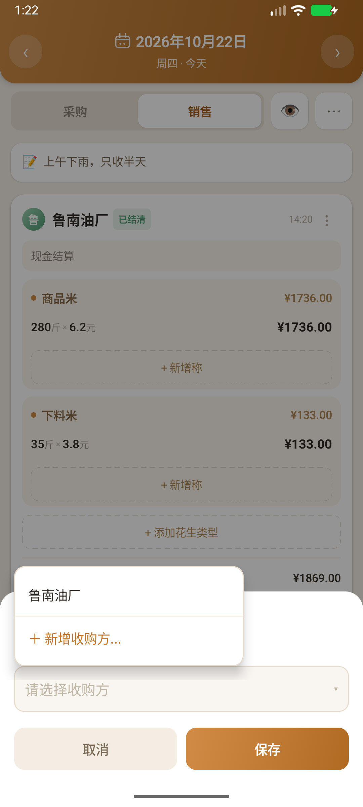

# 花生账本 · Peanut Ledger

参考 `demo_page.html` 原型实现的原生 Android 记账 App，用于花生收购与销售场景。**纯本地运行，不依赖服务端**，数据保存在设备本地。

## 功能

- **采购 / 销售双账本**：按日期分别记录农户采购和收购方销售。
- **日期与日历**：前一天 / 后一天、回到今天；日历支持日 / 月 / 年三级缩放，展示每日盈亏、月度与年度收支汇总，并用红点标记存在赊账的日期。
- **农户 / 收购方**：采购记录默认生成「户1、户2…」；销售可选择预设收购方，也可现场新增。
- **花生类型与称重**：每种类型可记录多称，填写重量和单价自动算金额；金额也可手动修改。新增称时会自动带入上次单价。
- **实付 / 实收调整**：支持抹零、按最低非零位向上取整、恢复原价，实时显示多付/少付、多收/少收。
- **销售结算状态**：赊账 / 已结清切换。
- **备注与重命名**：每日备注、单条记录备注、记录重命名、删除确认。
- **隐私模式**：一键隐藏全部金额；双击或长按单户卡片可临时显示该户金额；未显示时禁止修改称重、类型和实付金额。
- **设置**：管理采购花生类型、销售花生类型、收购方；支持清空全部记账数据（保留设置）。
- **本地持久化**：每次修改立即写入本地 JSON，重启 App 不丢失；首次安装预置一组示例数据便于体验。

> 按需求未实现登录与云端同步，后续可在现有数据层之上接入 Room / 服务端。

## 技术栈

- Kotlin
- Jetpack Compose + Material 3
- 单 Activity、单模块
- `SharedPreferences` + `org.json` 本地存储
- `minSdk 26` / `targetSdk 37` / `compileSdk 37`

## 项目结构

```
app/src/main/java/com/peanut/ledger/
├── MainActivity.kt              # 入口、沉浸式状态栏
├── data/
│   ├── Models.kt                # 数据模型、金额与格式化工具
│   └── LedgerRepository.kt      # JSON 序列化、本地存储、示例数据
└── ui/
    ├── PeanutLedgerApp.kt       # 根组件、Toast
    ├── LedgerState.kt           # 页面状态与全部业务操作
    ├── MainScreen.kt            # 首页、农户/收购方卡片、底部栏
    ├── Sheets.kt                # 新增/编辑、称重、备注、实付、确认弹层
    ├── CalendarSheet.kt         # 日/月/年日历
    ├── SettingsScreen.kt        # 设置页
    ├── Common.kt                # 输入框、按钮、标签等基础组件
    └── theme/                   # 品牌配色与字体
```

## 构建与运行

构建环境：JDK 17+、Android SDK 37。

```bash
./gradlew :app:assembleDebug
adb install -r app/build/outputs/apk/debug/app-debug.apk
```

也可以直接用 Android Studio 打开项目运行。调试 APK 输出在：

```
app/build/outputs/apk/debug/app-debug.apk
```

## 截图

| 首页 | 日历 |
| --- | --- |
|  |  |

| 新增称（自动带上次单价） | 隐私模式（长按单户显示） |
| --- | --- |
|  |  |

| 设置 | 新增收购（收购方下拉） |
| --- | --- |
|  |  |

## 说明

- 所有金额计算使用 `Double` 并统一保留两位小数；正式接入财务场景时建议替换为 `BigDecimal` 或以「分」为单位的整数。
- 示例数据仅在首次启动时写入；在设置中清空数据后不会再次自动生成。
